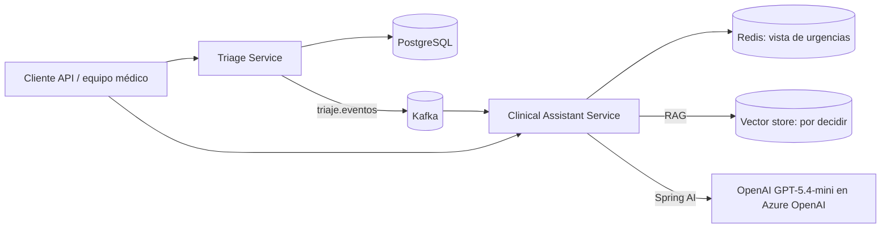

# Prueba Técnica Ceiba — VidaCruz

Backend para la prueba técnica de VidaCruz: dos microservicios Java reactivos, uno para triaje y otro para consultas de protocolos clínicos. El enunciado solicita APIs y eventos; no solicita frontend.

> **Estado:** repositorio en fase de análisis y esqueleto inicial. Las decisiones de arquitectura están documentadas, pero los flujos de negocio, la ejecución local integrada y el despliegue en Azure aún no están implementados. No hay todavía una URL desplegada.

## Servicios

| Servicio | Responsabilidad | Persistencia prevista |
|---|---|---|
| `triage-service` | Registro y clasificación, estados, SLA, escalamiento, auditoría, reportes y alertas | PostgreSQL con R2DBC |
| `clinical-assistant-service` | Consultas RAG y conteo de pacientes activos reconstruido desde Kafka | Redis para la vista de urgencias; vector store de RAG pendiente de selección |

Los servicios se construyen y despliegan por separado. Kafka integra ambos por el topic `triaje.eventos`; el Asistente no consulta la API de Triage para calcular el estado de urgencias.



## Stack y decisiones vigentes

- Java 17, Spring Boot 3.5, Spring WebFlux y Project Reactor.
- Gradle independiente por servicio.
- Triage: R2DBC/PostgreSQL y Kafka.
- Asistente: Redis reactivo, Kafka, Spring AI y OpenAI GPT-5.4-mini servido mediante Azure OpenAI/Microsoft Foundry.
- Arquitectura hexagonal liviana dentro de cada servicio.
- Alertas de escalamiento mediante SSE y persistencia para recuperación tras desconexiones.
- Azure Kubernetes Service (AKS), manifests Kubernetes e infraestructura como código con Terraform.

La API key y demás secretos deben configurarse en el entorno o en el gestor de secretos de Azure; no se guardan en el repositorio. El vector store y el modelo de embeddings siguen pendientes.

Las decisiones y sus consecuencias están en [`docs/adr/`](docs/adr/). Los requisitos exactos, reglas clínicas, datos E1–E6 y corpus están en [`docs/requirements/technical-test-baseline.md`](docs/requirements/technical-test-baseline.md). La arquitectura decidida es un diseño del proyecto, no una afirmación de que ya esté implementada.

## Requisitos previos

- JDK 17.
- Docker y Docker Compose serán necesarios para la ejecución integrada cuando se añada el archivo Compose. Actualmente no hay un Compose de desarrollo en el repositorio.

## Ejecutar los esqueletos actuales

Cada servicio tiene su propio Gradle Wrapper. En terminales separadas se pueden iniciar los esqueletos con:

```bash
cd triage-service
./gradlew bootRun
```

```bash
cd clinical-assistant-service
./gradlew bootRun --args='--server.port=8081'
```

Esto no inicia PostgreSQL, Kafka ni Redis y no representa todavía la ejecución funcional integrada que exige la prueba. La solución final deberá levantarlos junto con ambos servicios mediante un solo comando de Docker Compose.

## Verificación

Para ejecutar las pruebas Gradle de un servicio:

```bash
cd triage-service && ./gradlew test
```

```bash
cd clinical-assistant-service && ./gradlew test
```

Las pruebas de los flujos requeridos todavía deben implementarse: clasificación E1–E6, transiciones, escalamiento idempotente, citas RAG y abstención cuando no haya protocolo.

## Entregables aún pendientes

- Implementar las APIs, reglas de negocio, consumidores/productores Kafka, persistencia y RAG.
- Añadir pruebas unitarias y de integración para los flujos requeridos.
- Añadir Docker Compose para levantar dependencias y ambos servicios con un comando.
- Añadir Dockerfiles, manifests Kubernetes y Terraform para aprovisionar Azure.
- Configurar una canalización para construir/publicar las imágenes y desplegar los manifests en AKS.
- Desplegar y publicar aquí las URLs de las APIs accesibles.

La URL se agregará a esta sección cuando el despliegue exista y se haya verificado. No se deben usar datos clínicos reales con esta prueba ni interpretar el corpus provisto como guía médica validada.
