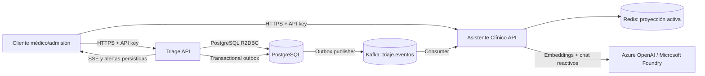
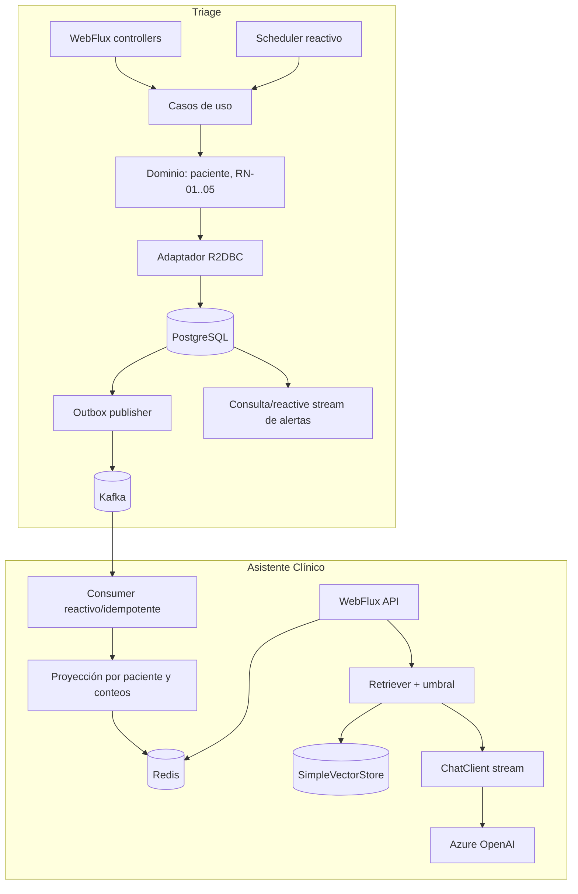

# Diseño de solución

## Propósito y alcance

Este documento convierte el PRD y el baseline del enunciado en un contrato técnico ejecutable para los dos servicios. El baseline conserva los umbrales de clasificación, SLA, casos E1–E6, corpus y texto exacto de los requisitos. Este diseño no los redefine.

La arquitectura es hexagonal liviana por microservicio. Cada proceso tiene dominio, casos de uso, persistencia y despliegue propios; la integración entre ellos ocurre por eventos Kafka. Se conserva Spring Boot 3.5.16 y Java 17 de los esqueletos existentes, WebFlux/Reactor en ambos servicios, R2DBC en Triage y Redis reactivo en Asistente.

## Vista de contexto



### Responsabilidades y dependencias

| Componente | Es dueño de | Adaptadores de salida | No debe |
|---|---|---|---|
| Triage | Pacientes, clasificación, ciclo de estados, SLA, escalamiento, auditoría, alertas y reportes | PostgreSQL/R2DBC, outbox/Kafka, reloj, SSE | Llamar a Asistente para completar un flujo; esperar disponibilidad de Kafka para confirmar una clasificación persistida |
| Asistente Clínico | Corpus RAG y proyección de pacientes activos por nivel | Kafka, Redis, Spring AI, Azure OpenAI | Consultar API o base de Triage para generar la vista de urgencias |
| Plataforma | Imágenes, red, configuración y secretos de ejecución | Terraform, ACR, AKS, Key Vault, CI/CD | Guardar valores secretos en Git o en el estado Terraform |

Dentro de cada aplicación, HTTP, scheduler y Kafka son adaptadores de entrada. Los casos de uso dependen de puertos de persistencia/publicación/modelo; las implementaciones R2DBC, Redis, Kafka y Spring AI viven fuera del dominio. No se comparte código de dominio ni tablas entre servicios.

## Componentes y flujos



### Contratos HTTP propuestos

Se mantienen las rutas del PDF/PRD: `POST /triage/pacientes`, `GET /triage/pacientes/{id}`, `PATCH /triage/pacientes/{id}/estado`, `GET /triage/reportes/operacion`, `GET /triage/alertas/stream`, `GET /triage/alertas`, `POST /asistente/consulta` y `GET /asistente/estado-urgencias`. Los DTO deben respetar las formas del baseline/PRD. Errores de validación son HTTP 400, transición inválida HTTP 409 y fallo de proveedor LLM HTTP 503. La respuesta del asistente conserva `{respuesta, fuentes:[{protocolo,seccion}]}`.

Las fechas API son ISO 8601 con offset; se normalizan a `Instant`/UTC al persistir. El contrato RAG acepta únicamente la pregunta y no registra su texto en logs. Los controladores devuelven `Mono`/`Flux` y no deben invocar `.block()`, JDBC/JPA ni clientes HTTP sincrónicos.

## Persistencia y consistencia

### Triage: PostgreSQL reactivo

PostgreSQL es la fuente de verdad de pacientes y auditoría. Las tablas mínimas son `patient`, `audit_event`, `medical_alert` y `outbox_event`; usar migraciones versionadas en cada servicio. Los UUID identifican paciente, evento y alerta. Las columnas temporales se guardan en UTC. La auditoría es append-only desde la API: no habrá operación de borrado ni actualización de entradas históricas.

Cada comando que cambia estado/flag escribe, en una transacción R2DBC local, el agregado, la auditoría requerida y sus salidas outbox. Restricciones únicas sobre `(patient_id, event_type, ... )` o el flag del agregado respaldan RN-03 bajo concurrencia. Para escalar, la actualización condicional debe exigir `status='REGISTRADO' AND escalated=false AND registered_at + sla < now`; una sola transacción ganadora crea auditoría, alerta y outbox. Las ejecuciones repetidas no crean efectos adicionales.

El scheduler procesa lotes acotados con paginación/`LIMIT`, evita materializar el conjunto completo, usa `UPDATE ... RETURNING` o equivalente PostgreSQL y limita concurrencia. El intervalo y reloj son configurables para pruebas. La API responde después del commit local; la publicación Kafka puede tardar y se observa como retraso de outbox. Esto mantiene Triage disponible si el broker cae y evita transacciones distribuidas.

### Asistente: Redis como proyección

Redis conserva el último estado por `patientId` (nivel, estado, `aggregateVersion`, eventos procesados) y los conteos por nivel. El consumidor actualiza estado y conteos de forma atómica, con script Lua o función equivalente, solo si la versión recibida es mayor; `eventId` evita reaplicar el mismo evento. `paciente_registrado` incrementa el nivel; `paciente_escalado` y `paciente_en_consulta` no cambian el conteo; `paciente_alta` decrementa una sola vez. Activo significa estado distinto de `ALTA`, tal como dice el PRD. Redis es una proyección reconstruible, no fuente de verdad.

Si Redis se pierde, el procedimiento operativo limpia la proyección y reproduce el topic desde el inicio retenido. Configurar retención Kafka mínima de siete días para el ejercicio y alertar si el retraso/antigüedad de reconstrucción supera esa ventana. Antes de truncar offsets o cambiar de grupo, documentar el procedimiento para no mezclar una proyección parcial con eventos antiguos. No se garantiza recuperación anterior a la retención configurada.

## Contrato Kafka y manejo de fallos

Topic requerido: `triaje.eventos`. Clave de partición: `patientId`, para conservar el orden por paciente. El envelope JSON versión 1 es:

```json
{
  "eventId": "uuid",
  "eventType": "paciente_registrado",
  "schemaVersion": 1,
  "aggregateId": "uuid-paciente",
  "aggregateVersion": 1,
  "occurredAt": "2026-11-07T12:00:00Z",
  "payload": {"patientId": "uuid-paciente", "nivel": "URGENTE", "estado": "REGISTRADO", "escalated": false}
}
```

Los tipos permitidos son `paciente_registrado`, `paciente_escalado`, `paciente_en_consulta` y `paciente_alta`. Cada evento lleva un snapshot completo y mínimo del nuevo estado (`patientId`, `nivel`, `estado`, `escalated`) junto con `aggregateVersion`; no incluye nombre, signos vitales ni edad. La versión aumenta con cada cambio publicable del paciente. El publisher preserva orden de versiones por paciente (un relay inicial o serialización por agregado al escalar). El consumidor ignora versiones iguales/antiguas y, al aplicar una versión mayor, compara el snapshot nuevo con el último estado materializado para ajustar los conteos. Como el snapshot es completo, también puede recuperarse de versiones saltadas; los saltos se miden y alertan para detectar retraso o pérdida. Eventos repetidos/versiones viejas no alteran conteo. Tipos o versiones de esquema no soportadas se enrutan a DLQ/error operativo, no se convierten silenciosamente.

El outbox publica con reintento y backoff; el evento se marca publicado solo tras confirmación del broker. Usar productor durable (`acks=all`, idempotencia habilitada) y RF de réplicas acorde al entorno. Para conservar orden por paciente, iniciar con un único relay; si se escala, serializar publicación por `aggregateId` y no permitir que una versión posterior salga antes que la anterior. La garantía observable es entrega al menos una vez, no exactly-once extremo a extremo. El Asistente es idempotente. Configurar reintentos limitados y dead-letter topic para eventos venenosos, con alerta y procedimiento de replay; no descartar silenciosamente. Una indisponibilidad de Kafka acumula outbox y aumenta lag, pero no bloquea el registro local de Triage. La capacidad de disco y política de alerta para backlog se revisan antes de desplegar.

La documentación oficial de Spring Kafka indica que los listeners async pueden devolver `Mono` desde 3.2 y completan el ack al finalizar; aun así, Kafka no convierte Redis y offsets en una transacción única. Confirmar la versión administrada por Spring Boot y configurar ack solo después de que la escritura Redis haya terminado correctamente.

## RF-05: semántica del reporte y consulta SQL

Decisiones de diseño para ambigüedades del enunciado:

- Normalizar instantes a UTC; `desde` es inclusivo y `hasta` exclusivo.
- El bucket por hora usa la hora UTC de `registered_at`; la fila de reporte representa registros cuya hora cae en el rango.
- `totalRegistrado` y conteos por nivel incluyen todos los registros del bucket.
- Espera se mide en minutos desde `registered_at` hasta el primer evento de entrada a consulta (`EN_CONSULTA`). Pacientes sin esa entrada se excluyen de promedio y p95, pero no del total ni del conteo por nivel. No se imputan como cero ni como el tiempo actual.
- p95 es `percentile_cont(0.95)` sobre esas duraciones observadas dentro del bucket; media y percentil se calculan en PostgreSQL.

La consulta usa agregación SQL con `FILTER`, CTE/subconsulta o funciones equivalentes para obtener el primer `EN_CONSULTA` por paciente, `date_trunc('hour', registered_at)` y agregados de duración. El resultado es un conjunto ya agrupado que se mapea a DTO; no se cargan pacientes a memoria para calcular métricas. Índices iniciales: `patient(registered_at, level)`, `audit_event(patient_id, event_type, occurred_at)` y los índices únicos idempotentes. Revisar plan con datos sintéticos al implementar, sin alterar semántica.

## RF-06: alerta SSE persistida y recuperable

En la misma transacción del escalamiento, Triage inserta una alerta persistida y eventos de auditoría/outbox. La tabla asigna `deliveryCursor` monotónico (`BIGINT`) además del `alertId` UUID público. Para que el cursor represente también el orden confirmado, el asignador incrementa una fila contadora singleton bajo lock transaccional (`SELECT ... FOR UPDATE`) y la conserva hasta commit; el breve lock serializa solo la inserción de alertas. GET pagina con `despuesDe=<deliveryCursor>`; SSE usa `id: <deliveryCursor>` para `Last-Event-ID` y envía datos mínimos (alertId, patientId, nivel, timestamp). No expone nombre ni signos vitales. El cliente deduplica por `alertId` porque reconexiones pueden repetir datos.

La tabla persistida es la autoridad; la conexión SSE no es almacenamiento. El flujo reactivo puede consultar periódicamente alertas posteriores al cursor y enviar heartbeat, evitando depender de un `Sink` local que pierde eventos al reiniciar o al balancear entre réplicas. La consulta histórica paginada y la conexión viven detrás de autenticación. No se promete entrega exactamente una vez ni notificación al cliente desconectado: la recuperación se hace consultando el historial desde el cursor monotónico. Esto cumple el canal escogido por ADR-0002 y deja explícito que no incluye correo/SMS/push.

## RAG, embeddings y modelo

Usar Spring AI 1.0.x compatible con Boot 3.5, generación `gpt-5.4-mini` servido por Azure OpenAI/Microsoft Foundry y embeddings `text-embedding-3-small` desde el mismo proveedor. Los deployment names y credenciales se configuran por entorno; Terraform usa la región seleccionada para el despliegue de prueba. El repositorio de vectores es `SimpleVectorStore` en memoria: es proporcional al corpus fijo de tres protocolos, no añade infraestructura y se reconstruye al iniciar. No es una elección para corpus dinámico o persistencia multi-instancia.

Al iniciar, el servicio divide el corpus versionado por protocolo y sección, incorpora metadata inmutable (`protocolId`, `sectionId`, `corpusVersion`) y calcula embeddings. La consulta busca un número pequeño y fijo de fragmentos; un umbral mínimo de similitud, configurable y calibrado con las tres consultas del baseline, decide si existe contexto. Si no hay resultado suficiente, retorna el aviso fijo de abstención sin invocar al LLM. Si hay coincidencia, se redacta únicamente con los fragmentos recibidos. El backend construye `fuentes` desde metadata recuperada, limita las fuentes a los fragmentos usados y no acepta identificadores inventados por el modelo.

Mantener la generación reactiva mediante `ChatClient.stream()`/`Flux` y la variante streaming de los advisors o composición Reactor equivalente. En Spring AI 1.0, `EmbeddingModel` y `VectorStore` exponen métodos síncronos (por ejemplo, `embed`/`similaritySearch`); aislar embedding de la pregunta y búsqueda en un scheduler `boundedElastic` dedicado, construido con límites configurados de hilos y cola, y un Bulkhead/circuit breaker/time limit en el puerto. `Mono.fromCallable(...).subscribeOn(embeddingScheduler)` evita event loop; al saturarse, rechaza con error controlado/HTTP 503 y nunca crea una cola sin límite. Medir saturación y fallos. La carga de corpus al inicio usa el mismo adaptador. El chat usa streaming HTTP reactivo; timeouts y circuit breaker protegen el proveedor. La API puede reunir el flujo en DTO JSON si el contrato exige respuesta completa; establecer límite de tokens/salida. No habilitar herramientas ni acciones del modelo.

Aplicar Resilience4j Circuit Breaker y timeout tanto al embedding durante carga/consulta como al puerto de generación. Fallo de generación produce HTTP 503 claro; ausencia de coincidencia no es error y produce abstención HTTP 200. En test, sustituir puertos de modelo/embeddings por dobles deterministas y verificar que el adaptador síncrono corre fuera del event loop, respeta timeout/concurrencia y propaga fallo del circuito. `SimpleVectorStore` requiere embeddings reales si se valida búsqueda semántica de integración; estas pruebas pueden usar proveedor mockeado y corpus/respuestas controladas.

## Seguridad y privacidad

Mecanismo elegido: API key distinta por servicio en header `X-API-Key`, validada en filtro WebFlux. Se elige por la demostración acotada sin emisor de identidad ni necesidad de roles; no representa identidad individual ni autorización granular. No exponer endpoints de escritura/consulta sin autenticación. Health/liveness puede ser público solo si no revela datos; readiness y métricas quedan restringidas a red interna o autenticación de operación.

En AKS, guardar API keys y Azure OpenAI key en Azure Key Vault; montar o sincronizar secretos usando Microsoft Entra Workload ID/CSI y permisos mínimos por workload. El estado Terraform contiene referencias e IDs, nunca valores secretos. En CI, usar federación OIDC de GitHub Actions hacia Azure en lugar de credenciales estáticas cuando el repositorio/suscripción lo permita; restringir permisos por entorno y proteger rama. Localmente, cargar claves desde `.env` excluido de Git. Rotar claves sin rebuild de imagen.

Terminar TLS en el gateway/ingress público, habilitar probes, límites de requests/tamaño, validación Bean Validation y CORS cerrado (no se entrega frontend). No registrar tokens, API keys, prompt, nombre, signos vitales o respuesta clínica completa. Correlacionar con `traceId` y `patientId` pseudónimo/UUID solo donde sea operativo necesario. El corpus de prueba no es fuente clínica validada; el servicio no debe presentarse como dispositivo ni sistema de decisión clínica.

## Reactividad y límites de concurrencia

- Todas las rutas externas, R2DBC, Redis, Kafka y cliente HTTP del modelo permanecen no bloqueantes.
- El trabajo de carga de embeddings al arranque puede usar `ApplicationRunner` reactivo que se completa antes de readiness; no bloquear el event loop. Si alguna biblioteca inevitablemente bloquea, aislarla en `boundedElastic` con concurrencia acotada y documentada.
- Limitar `flatMap` concurrency, tamaño de lote de outbox y scheduler; no usar `collectList()` sobre streams sin límite.
- Usar deadlines propagados, timeouts HTTP/Kafka/Redis y manejo de cancelación. Backpressure en SSE incluye heartbeat y política de cliente lento: cancelar conexión; la recuperación se realiza por historial.
- Configurar Connection Pool de R2DBC/Redis acorde al límite de conexiones del servicio y del entorno. Evitar múltiples réplicas de consumidor con actualización no atómica de conteos; Redis script/version check es requisito.

## Entorno local, pruebas y operación

`docker compose up --build` debe levantar PostgreSQL, Kafka KRaft de un nodo, Redis y ambos servicios. Los servicios usan perfil local y configuración por variables; el proveedor Azure se activa con claves locales. Para recorrido sin credenciales de nube, un perfil de desarrollo puede sustituir únicamente los puertos de embeddings/chat con dobles etiquetados claramente y no se usa para producción. Readiness de Asistente requiere Kafka y Redis para mantener/servir la vista de urgencias, pero no depende de Azure OpenAI: si el proveedor cae o embeddings no están disponibles al arranque, el servicio permanece listo para la proyección y el endpoint RAG devuelve 503 hasta recuperarse. Readiness de Triage tampoco depende de Asistente ni Kafka (la cola outbox puede crecer y alertar).

Pruebas que deben implementarse según PRD y baseline:

| Nivel | Verificaciones mínimas |
|---|---|
| Unitarias | Validación de campos y RN-01 con E1–E6; RN-02; transiciones; límites temporales; idempotencia del dominio; reglas de abstención y composición de fuentes |
| Integración Triage | PostgreSQL/R2DBC: transacciones, outbox, auditoría append-only, transición concurrente de escalamiento y query RF-05 contra casos con/sin consulta |
| Integración Kafka/proyección | Kafka + Redis: orden por patientId, entrega repetida, versión vieja, alta decrementada una vez, replay/reconstrucción y eventos inválidos/DLT |
| API | HTTP 400/409/503, API key, contratos JSON, SSE replay por `Last-Event-ID` y desconexión/reconexión |
| RAG | Dos respuestas con citas PROTO-001/002, abstención exacta para diabetes, fuente siempre del corpus, proveedor caído y latencia/error del circuito |
| Entrega | Compose levanta un stack, probes y logs/métricas no exponen secretos, manifests Terraform/AKS aplican y las URLs responden por HTTPS |

Usar JUnit/Spring Boot Test, Testcontainers PostgreSQL/Kafka/Redis cuando aporte fidelidad. Chat y embeddings se sustituyen por dobles; no usar servicios externos en pruebas ordinarias. Micrometer registra conteos por nivel, escalaciones, outbox lag, consumer lag, latencia/error del LLM, breaker state y conexiones SSE; no usar IDs de paciente como etiquetas métricas de alta cardinalidad. Logs JSON llevan `traceId`, servicio, operación, estado HTTP y duración.

## Kubernetes, Terraform y CI/CD

Destino: AKS conforme ADR-0004. Cada servicio tiene su propio `Deployment`, `Service` `ClusterIP`, `ServiceAccount`, ConfigMap no secreto y probes startup/readiness/liveness. Réplicas y recursos se dimensionan para la demostración; solicitudes/límites explícitos. PostgreSQL, Kafka y Redis corren como servicios gestionados en Azure; Terraform aprovisiona Azure Database for PostgreSQL Flexible Server, Azure Event Hubs con endpoint Kafka compatible (validar compatibilidad/feature exigida al implementar) y Azure Managed Redis en la región seleccionada. No se operan bases StatefulSet propias para este ejercicio.

Terraform crea el grupo dedicado `rg-pruebatecnicaceiba-<sufijo>` con tag `project=PruebaTecnicaCeiba`, AKS, ACR, red/identidades, Key Vault, permisos, observabilidad básica y recursos gestionados seleccionados; el estado remoto y los recursos de la prueba quedan en ese grupo sin dependencias compartidas. Azure Managed Redis es la opción prevista, sujeta a disponibilidad regional; evita iniciar sobre Azure Cache for Redis Basic/Standard/Premium, cuyo retiro Microsoft anunció para el 30-09-2028. Pipeline: validación estática, pruebas, build de dos imágenes, push con tag inmutable a ACR, plan/apply de infra según entorno y rollout de manifests; deploy protegido por branch/environment. Tras la evaluación se ejecuta un script local ignorado por Git que valida suscripción, nombre y tag del grupo, muestra los recursos y pide una confirmación exacta antes de eliminar el grupo completo. No se aplica Terraform en cada despliegue de aplicación si la infraestructura no cambió.

El despliegue usa la suscripción Azure del usuario. Terraform recibe `subscription_id` y `location` como variables; el usuario aporta esos valores al aplicar la infraestructura y no se tratan como preguntas abiertas de diseño. Los recursos son temporales para esta prueba técnica y se eliminan después de la evaluación; no se mantienen como infraestructura permanente. La URL pública y TLS deben operar durante la evaluación; la configuración concreta acompaña el endpoint elegido. No se aprovisiona infraestructura durante esta fase.

## Trazabilidad de requisitos

| PRD | RF / RN fuente | Decisión/parte de diseño | Evidencia que debe probarse |
|---|---|---|---|
| PRD-FR-01 | RF-01, RN-01, RN-02 | Triage + PostgreSQL reactivo; validación, clasificación priorizada y SLA determinista | E1–E6 exactos; HTTP 400; SLA por nivel |
| PRD-FR-02 | RF-02, RN-04 | Transiciones del agregado y auditoría + outbox en transacción | Transiciones permitidas/prohibidas, auditoría, evento de transición |
| PRD-FR-03 | RF-03, RN-02, RN-03 | Scheduler por lotes y actualización condicional idempotente | Umbral exacto por nivel, carrera/reintento, sin escalar en consulta/alta |
| PRD-FR-04 | RF-05 | Consulta SQL UTC, bucket por registro, `percentile_cont` en PostgreSQL | Conteos y p95 con pacientes atendidos y pendientes; límites `[desde,hasta)` |
| PRD-FR-05 | RF-06, RN-04 | Alerta persistida y SSE autenticado recuperable | Escalamiento produce alerta; replay tras desconexión; payload mínimo |
| PRD-FR-06 | RF-04B | Kafka versionado + Redis projection atómica por versión | Estado activo y conteos; alta una sola vez; replay sin Triage API |
| PRD-FR-07 | RF-04A, RN-05 | Spring AI RAG, vector store en memoria, embeddings remotos y abstención previa | Citas PROTO-001/002; caso diabetes solo aviso; HTTP 503 si proveedor falla |
| NFR transversales | Reactividad, Kafka, seguridad, observabilidad, pruebas, despliegue | WebFlux/R2DBC, outbox, API key, Workload ID, Micrometer, Compose/AKS/Terraform | Tests automatizados, probes, secretos no versionados, URLs HTTPS accesibles |

## Decisiones, supuestos y puntos externos

### Decisiones de diseño adoptadas

1. Outbox en PostgreSQL es el puente consistente entre mutaciones Triage y Kafka; entrega al menos una vez e idempotencia del consumidor (ADR-0005).
2. Contrato JSON v1 y partición por paciente; no se incluyen datos personales ni signos vitales.
3. Redis es proyección reconstruible con guarda de versión y cambios atómicos.
4. Semántica RF-05 queda fijada en UTC, intervalo `[desde,hasta)`, bucket por registro y exclusión de pacientes no consultados solo de espera promedio/p95.
5. RF-06 usa alerta persistida como fuente de verdad, SSE con cursor y recuperación por consulta; entrega al menos una vez al cliente.
6. RAG usa `SimpleVectorStore` por corpus pequeño e inmutable, `text-embedding-3-small` y genera fuentes desde metadata; el umbral se calibra, no se inventa como valor definitivo.
7. API key independiente por servicio; Key Vault y workload identity en AKS.

### Supuestos de implementación

- Topic con retención de siete días como mínimo.
- `SimpleVectorStore` se inicializa antes de readiness; escala a una instancia de Assistant para evitar inconsistencias de store en memoria. La proyección Redis sí admite múltiples réplicas por actualización atómica.
- Alertas SSE usan polling reactivo a la tabla persistida para sobrevivir reinicios y balanceo; la cadencia se configura para no cargar PostgreSQL.
- Azure ofrece embeddings y modelo de chat en una región aceptable; el modelo y despliegues se validan con consultas requeridas.
- Los endpoints y campos concretos que el baseline/PRD no especifica se completan en contratos OpenAPI al planificar implementación, manteniendo estas semánticas.

### Parámetros del despliegue temporal

- Terraform acepta `subscription_id` y `location` para aplicar los recursos en la cuenta Azure del usuario; la región concreta se entrega en el despliegue, no es una decisión pendiente del diseño.
- Los nombres de los deployments Azure OpenAI se configuran por entorno para `gpt-5.4-mini` y `text-embedding-3-small`.
- La implementación valida Event Hubs Kafka contra el productor, consumidor, retención y garantías escogidas.
- El grupo dedicado y los recursos asociados se eliminan al finalizar la evaluación con el script local.

Estos parámetros no convierten la prueba en un servicio de producción ni agregan alcance clínico. Ninguno cambia RN-01 a RN-05.

## Decisiones diferidas a implementación

- Nombres exactos de tablas/índices, clases y paquetes dentro de hexagonal.
- Cadencia del scheduler/SSE polling, lotes, timeouts, retry/backoff y umbral numérico RAG, que se calibran con casos del PRD.
- Cantidad de particiones Kafka y réplicas AKS, dimensionadas para la demostración; ordenar por paciente permanece invariante.
- Gateway/ingress, DNS final y configuración de certificado, condicionado por disponibilidad regional y dominio.
- Ajustes de SQL tras medición de plan con datos de prueba, conservando la semántica RF-05.

## Decisiones y fuentes técnicas

- [ADR-0001: arquitectura hexagonal liviana](../../../docs/adr/0001-arquitectura-hexagonal.md)
- [ADR-0002: alertas SSE](../../../docs/adr/0002-alertas-medicas-sse.md)
- [ADR-0003: Spring AI y modelo OpenAI](../../../docs/adr/0003-spring-ai-y-modelo-openai.md)
- [ADR-0004: AKS y Terraform](../../../docs/adr/0004-aks-terraform-y-despliegue.md)
- [ADR-0005: outbox y contrato Kafka](../../../docs/adr/0005-outbox-y-contrato-kafka.md)
- [Spring AI 1.0 ChatClient y notas de stack reactivo](https://docs.spring.io/spring-ai/reference/1.0/api/chatclient.html)
- [Spring AI 1.0 EmbeddingModel (métodos síncronos)](https://docs.spring.io/spring-ai/reference/1.0/api/embeddings.html)
- [Spring AI 1.0 vector stores y API síncrona](https://docs.spring.io/spring-ai/reference/1.0/api/vectordbs.html)
- [Spring Kafka 3.3: listeners asíncronos (`Mono`)](https://docs.spring.io/spring-kafka/reference/3.3/kafka/receiving-messages/async-returns.html)
- [Microsoft Foundry: catálogo de modelos vendidos por Azure](https://learn.microsoft.com/en-us/azure/foundry/foundry-models/concepts/models-sold-directly-by-azure)
- [Microsoft Entra Workload ID en AKS](https://learn.microsoft.com/en-us/azure/aks/workload-identity-overview)
- [AKS y Azure Key Vault CSI](https://learn.microsoft.com/en-us/azure/aks/csi-secrets-store-identity-access)
- [Azure Cache for Redis: retiro y Azure Managed Redis](https://learn.microsoft.com/en-us/azure/azure-cache-for-redis/retirement-faq)
- [AKS con Terraform](https://learn.microsoft.com/en-us/azure/aks/learn/quick-kubernetes-deploy-terraform)

